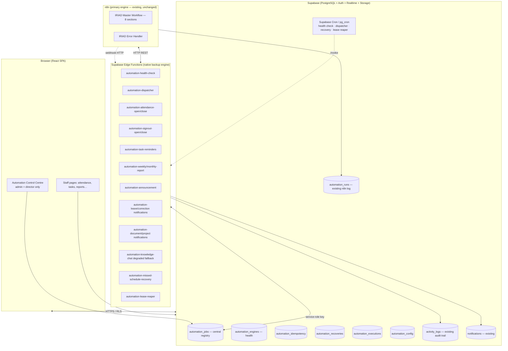

# IRIAD — Dual Automation Engine: Proposed Architecture

**Phase 2 deliverable** (per the Dual Automation Engine brief, §11 Phase 2).
**Status:** Design only — no application, database, migration, workflow, or production data has been changed by this document. It builds on `docs/DUAL_AUTOMATION_INVENTORY.md` (Phase 1).

Review this architecture before any implementation. Conflicts and open questions are listed in §12.

---

## 1. Goals

| Goal | How it is achieved |
|------|--------------------|
| n8n remains the primary engine; existing workflows preserved | All n8n JSON files untouched; n8n keeps executing existing business workflows |
| Independent native backup engine | TypeScript + Supabase Edge Functions + PostgreSQL + Supabase Cron; no dependency on n8n, Claude Code, or browser timers |
| Both engines share one execution registry | Central `automation_jobs` table; both engines claim jobs through the same atomic function |
| Effectively-once business effects (no duplicate execution) | Shared idempotency keys, unique constraints, atomic claiming with leases, reconciliation for timeouts |
| Automatic, administrator-configurable failover | Health checks → engine health table → backup activation; toggle in Control Centre |
| Missed schedule recovery | DB-driven recovery job that scans for missed/pending scheduled jobs |
| Staff locked out of infrastructure controls | RLS + route guard + navigation; staff never see automation infra pages |
| Audit of every administrative action | `activity_logs` (existing table) extended to automation actions |

> **Architecture stance (hybrid, not replacement):** Existing n8n Master Workflow
> is the permanent primary automation workflow. The native IRIAD engine is an
> independent secondary failover engine. The project is a hybrid architecture,
> not an n8n replacement. The n8n Master JSON is preserved unchanged; no
> business logic is moved out of n8n, and the native engine only executes when
> n8n is unhealthy or a workflow fails.

---

## 2. Component diagram



**Data flow (normal operation, n8n healthy):**
1. `automation-health-check` pings n8n every minute → updates `automation_engines`.
2. `automation-dispatcher` claims due `Pending`/`Dispatched`/`Retrying` jobs via `claim_automation_job()` → sets `current_engine = 'n8n'`, status `Running`, lease.
3. Dispatcher calls n8n (existing webhooks/HTTP) or records an `automation_runs` row; n8n executes existing workflow logic unchanged.
4. n8n reports completion → job status `Completed`, result stored, idempotency record `completed`.

**Data flow (n8n unavailable):**
1. Health check fails repeatedly → `automation_engines.status = 'unhealthy'` for n8n.
2. Dispatcher claims the same job with `current_engine = 'iriad-native'`.
3. Native Edge Function executes the equivalent business operation directly in PostgreSQL.
4. Result recorded; administrators notified via `notifications` + (if configured) fallback email.

---

## 3. New schema — Migration 011 (`supabase/migrations/011_automation_engine.sql`)

All new tables are organisation-scoped where applicable, RLS enabled, and follow the existing naming/policy conventions (migrations 001–010). `automation_engines` and `automation_config` are platform-level (`organisation_id` nullable).

### 3.1 DDL

```sql
-- Migration 011: Dual automation engine foundation
-- Central job registry, engine health, idempotency records, recovery records,
-- automation configuration. Additive: no existing table is altered.

-- 0. Extensions used by cron (pg_cron availability confirmed before apply)
create extension if not exists pg_cron;

-- 1. Engine health registry
create table if not exists public.automation_engines (
  id uuid primary key default gen_random_uuid(),
  name text not null unique check (name in ('n8n','iriad-native')),
  kind text not null check (kind in ('primary','backup')),
  status text not null default 'unknown' check (status in ('healthy','degraded','unhealthy','unknown')),
  last_health_check_at timestamptz,
  last_successful_health_check_at timestamptz,
  consecutive_failures integer not null default 0,
  failure_threshold integer not null default 3,
  health_check_interval_seconds integer not null default 60,
  auto_failover_enabled boolean not null default true,
  preferred_engine text not null default 'n8n' check (preferred_engine in ('n8n','iriad-native')),
  max_retries integer not null default 3,
  retry_delay_seconds integer not null default 60,
  config jsonb not null default '{}'::jsonb,
  organisation_id uuid references public.organisations(id) on delete cascade,
  created_at timestamptz not null default now(),
  updated_at timestamptz not null default now()
);

-- 2. Central job registry (the single source of truth for every automation job)
create table if not exists public.automation_jobs (
  id uuid primary key default gen_random_uuid(),
  job_id text not null unique,                    -- e.g. attendance-open-org-...-2026-11-09
  idempotency_key text not null unique,            -- shared by both engines for the same business op
  workflow_name text not null,                     -- n8n workflow name or native function name
  business_operation text not null check (business_operation in (
    'attendance_open','attendance_close','signout_open','signout_close',
    'staff_checkin','staff_checkout','daily_attendance_report','weekly_report',
    'monthly_report','leave_notification','leave_approval','correction_notification',
    'correction_approval','task_assignment','task_deadline_reminder','announcement_notification',
    'document_notification','project_notification','knowledge_ingestion','knowledge_chat',
    'error_alert','recovery'
  )),
  trigger_type text not null check (trigger_type in ('schedule','webhook','event','manual','recovery')),
  scheduled_at timestamptz not null,
  primary_engine text not null default 'n8n' check (primary_engine in ('n8n','iriad-native')),
  backup_engine text not null default 'iriad-native' check (backup_engine in ('n8n','iriad-native')),
  current_engine text check (current_engine in ('n8n','iriad-native')),
  status text not null default 'Pending' check (status in (
    'Pending','Dispatched','Acknowledged','Running','Completed','Failed',
    'Timed Out','Uncertain','Retrying','Recovered','Cancelled'
  )),
  attempt_number integer not null default 0,
  retry_count integer not null default 0,
  max_retries integer not null default 3,
  execution_id text,                               -- n8n execution id when dispatched to n8n
  lease_holder text,                               -- engine instance that claimed the job
  lease_expires_at timestamptz,
  heartbeat_at timestamptz,
  acknowledged_at timestamptz,
  started_at timestamptz,
  completed_at timestamptz,
  error_details jsonb default '{}'::jsonb,
  execution_result jsonb default '{}'::jsonb,
  recovery_status text,
  organisation_id uuid references public.organisations(id) on delete cascade,
  created_at timestamptz not null default now(),
  updated_at timestamptz not null default now(),
  constraint lease_after_start check (
    lease_expires_at is null or started_at is null or lease_expires_at > started_at
  )
);

-- 3. Execution history (one row per attempt)
create table if not exists public.automation_executions (
  id uuid primary key default gen_random_uuid(),
  job_id uuid not null references public.automation_jobs(id) on delete cascade,
  engine text not null check (engine in ('n8n','iriad-native')),
  attempt_number integer not null,
  status text not null check (status in ('running','completed','failed','timed_out')),
  started_at timestamptz not null default now(),
  completed_at timestamptz,
  result jsonb default '{}'::jsonb,
  error jsonb default '{}'::jsonb,
  created_at timestamptz not null default now()
);

-- 4. Durable idempotency records (shared by both engines)
create table if not exists public.automation_idempotency (
  idempotency_key text primary key,
  business_operation text not null,
  organisation_id uuid references public.organisations(id) on delete cascade,
  status text not null default 'pending' check (status in ('pending','completed','failed')),
  result jsonb default '{}'::jsonb,
  created_at timestamptz not null default now(),
  completed_at timestamptz
);

-- 5. Recovery records
create table if not exists public.automation_recoveries (
  id uuid primary key default gen_random_uuid(),
  job_id uuid not null references public.automation_jobs(id) on delete cascade,
  reason text not null check (reason in (
    'n8n_down','workflow_failure','timeout','missed_schedule','lease_expired','manual'
  )),
  recovered_by_engine text not null check (recovered_by_engine in ('n8n','iriad-native')),
  recovered_at timestamptz not null default now(),
  notes text
);

-- 6. Administrator automation configuration (per organisation)
create table if not exists public.automation_config (
  id uuid primary key default gen_random_uuid(),
  organisation_id uuid not null references public.organisations(id) on delete cascade,
  key text not null,
  value jsonb not null default '{}'::jsonb,
  description text,
  updated_at timestamptz not null default now(),
  updated_by uuid references public.profiles(id) on delete set null,
  unique (organisation_id, key)
);

-- Seed engines for the IRIAD organisation
insert into public.automation_engines (name, kind, status, preferred_engine, organisation_id)
select 'n8n', 'primary', 'unknown', 'n8n', id from public.organisations where slug = 'iriad'
on conflict (name) do nothing;
insert into public.automation_engines (name, kind, status, preferred_engine, organisation_id)
select 'iriad-native', 'backup', 'unknown', 'n8n', id from public.organisations where slug = 'iriad'
on conflict (name) do nothing;

-- Indexes
create index if not exists idx_automation_jobs_status_schedule on public.automation_jobs(status, scheduled_at)
  where status in ('Pending','Dispatched','Retrying');
create index if not exists idx_automation_jobs_idempotency on public.automation_jobs(idempotency_key);
create index if not exists idx_automation_jobs_job_id on public.automation_jobs(job_id);
create index if not exists idx_automation_jobs_org on public.automation_jobs(organisation_id);
create index if not exists idx_automation_jobs_engine on public.automation_jobs(current_engine);
create index if not exists idx_automation_jobs_lease on public.automation_jobs(lease_expires_at)
  where lease_expires_at is not null;
create index if not exists idx_automation_jobs_business on public.automation_jobs(business_operation, scheduled_at);
create index if not exists idx_automation_executions_job on public.automation_executions(job_id, attempt_number);
create index if not exists idx_automation_recoveries_job on public.automation_recoveries(job_id);
create index if not exists idx_automation_config_org on public.automation_config(organisation_id);

-- Enable RLS
alter table public.automation_engines enable row level security;
alter table public.automation_jobs enable row level security;
alter table public.automation_executions enable row level security;
alter table public.automation_idempotency enable row level security;
alter table public.automation_recoveries enable row level security;
alter table public.automation_config enable row level security;

-- RLS: read within own organisation (platform-level rows have null organisation_id and are
-- readable by admins/directors via the manage policies below)
create policy automation_engines_select_own on public.automation_engines
  for select using (
    organisation_id is null
    or organisation_id in (select organisation_id from public.profiles where id = auth.uid())
  );
create policy automation_engines_manage_admin on public.automation_engines
  for all using (
    organisation_id in (select organisation_id from public.profiles where id = auth.uid())
    and exists (
      select 1 from public.profiles p where p.id = auth.uid()
      and p.role in ('admin','director')
    )
  );

create policy automation_jobs_select_own on public.automation_jobs
  for select using (
    organisation_id is null
    or organisation_id in (select organisation_id from public.profiles where id = auth.uid())
  );
create policy automation_jobs_manage_admin on public.automation_jobs
  for all using (
    organisation_id in (select organisation_id from public.profiles where id = auth.uid())
    and exists (
      select 1 from public.profiles p where p.id = auth.uid()
      and p.role in ('admin','director')
    )
  );

create policy automation_executions_select_own on public.automation_executions
  for select using (
    organisation_id is null
    or exists (
      select 1 from public.automation_jobs j
      where j.id = automation_executions.job_id
        and (j.organisation_id is null or j.organisation_id in (
          select organisation_id from public.profiles where id = auth.uid()
        ))
    )
  );

create policy automation_idempotency_select_own on public.automation_idempotency
  for select using (
    organisation_id is null
    or organisation_id in (select organisation_id from public.profiles where id = auth.uid())
  );

create policy automation_recoveries_select_own on public.automation_recoveries
  for select using (
    exists (
      select 1 from public.automation_jobs j
      where j.id = automation_recoveries.job_id
        and (j.organisation_id is null or j.organisation_id in (
          select organisation_id from public.profiles where id = auth.uid()
        ))
    )
  );

create policy automation_config_select_own on public.automation_config
  for select using (
    organisation_id in (select organisation_id from public.profiles where id = auth.uid())
  );
create policy automation_config_manage_admin on public.automation_config
  for all using (
    organisation_id in (select organisation_id from public.profiles where id = auth.uid())
    and exists (
      select 1 from public.profiles p where p.id = auth.uid()
      and p.role in ('admin','director')
    )
  );
```

### 3.2 Reused existing tables (no duplication)

| Table | Role in dual-engine design |
|-------|----------------------------|
| `automation_runs` | n8n execution log (workflow_name, trigger, status, input/output/error) — retained as n8n-side history alongside the new registry |
| `activity_logs` | Audit trail for every Control Centre action (actor_id, action, target_type, target_id, metadata) |
| `notifications` | Admin alerts (failover activation, failures, recovery events) |
| `email_logs` | External email delivery attempts + provider message IDs (idempotency evidence for emails) |
| `generated_reports.idempotency_key` | Existing report idempotency pattern; native report jobs reuse the same key scheme |
| `system_settings` | Existing key/value store; `automation_config` is preferred going forward, but existing keys (`report_weekly_deadline`, etc.) remain unchanged |
| `working_calendar` | Holiday/workday awareness for missed-schedule recovery |
| `report_schedules` | Admin-configured reporting deadlines/recipients — reused, not duplicated |

---

## 4. Job state machine

```
Pending ──claimed by scheduler──▶ Dispatched ──acknowledged──▶ Acknowledged ──engine starts──▶ Running
                                                    │                            │
                                                    │ (n8n failure event)        │ (completes)
                                                    ▼                            ▼
                                                Failed ◀──────── Recoverable ───── Completed
                                                    │                          ▲
                                                    │ retries left               │ (idempotent re-claim blocked)
                                                    ▼                          │
                                                Retrying ─────retry delay─────▶ Dispatched
                                                    │
                                                    │ retries exhausted
                                                    ▼
                                                 Failed (terminal)
Running ──lease expires without completion──▶ Timed Out ──reconcile──▶ Uncertain
Uncertain ──business effect verified──▶ Completed
Uncertain ──no safe evidence──▶ Failed ──backup engine──▶ Recovered
Any failed job ──admin/manual recovery──▶ Recovered (recovery_status set)
```

### 4.1 Transition rules

| From → To | Triggered by | Condition |
|-----------|--------------|-----------|
| Pending → Dispatched | `automation-dispatcher` cron | `scheduled_at <= now()` and engine healthy |
| Dispatched → Acknowledged | Engine confirms receipt / n8n execution started | `acknowledged_at` set; `execution_id` recorded for n8n |
| Acknowledged → Running | Engine begins execution | `started_at` set, lease taken |
| Running → Completed | Engine reports success | `completed_at`, `execution_result`, idempotency `completed` |
| Running → Failed | Engine reports error | `error_details`, `retry_count` incremented |
| Running → Timed Out | Lease expiry (no heartbeat before `lease_expires_at`) | Job marked `Timed Out`, then `Uncertain` |
| Failed → Retrying | `retry_count < max_retries` | Backoff `retry_delay_seconds` |
| Failed → Failed (terminal) | `retry_count >= max_retries` | No further automatic attempts |
| Timed Out → Uncertain | Timeout detected | Duplicate execution must be ruled out first |
| Uncertain → Completed | Reconciliation confirms business effect | Idempotency record `completed` or business row exists |
| Uncertain → Failed / Recoverable | Reconciliation inconclusive | Backup engine may execute once safely |
| Any → Recovered | Backup engine completes equivalent op | `recovery_status = 'Recovered'`, recovery record inserted |

**Rule: a job in `Uncertain` is never automatically re-executed by n8n until reconciliation rules out a completed business effect.** See §6 (Scenario D).

---

## 5. Atomic job claiming

Both engines claim jobs through one PostgreSQL function so two engines can never execute the same job:

```sql
create or replace function public.claim_automation_job(p_engine text)
returns setof public.automation_jobs
language plpgsql
as $$
begin
  return query
  with locked as (
    select id from public.automation_jobs
    where status in ('Pending','Dispatched','Retrying')
      and scheduled_at <= now()
      and (lease_expires_at is null or lease_expires_at < now())
    order by scheduled_at asc
    for update skip locked
    limit 1
  )
  update public.automation_jobs j
  set status = 'Running',
      current_engine = p_engine,
      lease_holder = p_engine,
      lease_expires_at = now() + make_interval(secs => 600),  -- 10-minute lease
      heartbeat_at = now(),
      started_at = coalesce(j.started_at, now()),
      attempt_number = j.attempt_number + 1,
      updated_at = now()
  from locked l
  where j.id = l.id
  returning *;
end;
$$;
```

- `FOR UPDATE SKIP LOCKED` lets concurrent dispatcher instances each claim a different job without blocking.
- Lease expiry + heartbeat drives the `Uncertain` state machine (§4).
- Edge Functions invoke this function via the Supabase client with the service-role key (RLS bypassed for trusted server code).

**Idempotency guard inside execution:** before performing a business effect, the engine checks `automation_idempotency[idempotency_key]`. If `completed`, it skips the effect and records `Completed` without side effects. If `pending`, it inserts a `pending` idempotency row inside the same transaction as the business effect, performs the effect, then marks `completed` with the provider acknowledgement (e.g. `email_logs.provider_message_id`).

---

## 6. Failover scenarios (brief §4)

### Scenario A — n8n healthy
1. `automation-health-check` GETs n8n health endpoint → `automation_engines.status = 'healthy'` for n8n.
2. Dispatcher claims eligible job → `current_engine = 'n8n'`, status `Running`.
3. Dispatcher invokes n8n (existing webhook / HTTP) → n8n returns execution ID → status `Acknowledged`, `execution_id` stored.
4. n8n completion (webhook callback or `automation_runs` poll) → `Completed`, result stored, idempotency `completed`.

### Scenario B — n8n unavailable
1. Health check fails `failure_threshold` times consecutively → `automation_engines.status = 'unhealthy'` for n8n; `iriad-native` marked active.
2. Dispatcher claims eligible jobs with `current_engine = 'iriad-native'`.
3. Native Edge Function executes equivalent business operation directly against PostgreSQL (e.g. upsert `attendance_sessions`, insert `notifications`).
4. Result recorded → `Completed` or `Failed`; administrators notified via `notifications` and configured fallback alert.

### Scenario C — Individual n8n workflow failure
1. Failure event / n8n Error Handler logs to `automation_runs` → corresponding job identified by `workflow_name` + `execution_id`.
2. Check `automation_idempotency[idempotency_key]`: if `completed`, no action (operation already done).
3. If safe (idempotent or not yet executed), transfer to backup engine: new claim with `current_engine = 'iriad-native'`, `recovery_status = 'Recovering'`.
4. Backup engine executes equivalent op → record recovery event in `automation_recoveries`; notify administrators per alert policy.

### Scenario D — n8n timeout (never treated as proof of non-execution)
1. Mark job `Uncertain` (not `Failed`).
2. Check n8n execution status using `execution_id`; check `automation_idempotency[idempotency_key]`.
3. Reconcile: confirmed completed → `Completed`; confirmed failed → `Failed`; inconclusive → allow backup engine **only** when duplicate business execution is safely prevented (idempotency key free or business row absent).
4. Record reconciliation evidence in `execution_result` / `error_details`.

### Scenario E — n8n recovery
1. Health check succeeds → `automation_engines.status = 'healthy'` for n8n; confirm it accepts new jobs (test dispatch).
2. Resume primary execution for **new** eligible jobs.
3. Do **not** automatically replay `Completed` or `Uncertain` operations.
4. Preserve backup execution history (`automation_executions`, `automation_recoveries`) for the audit trail.

Automatic failover on/off and preferred engine are stored in `automation_config` / `automation_engines.auto_failover_enabled` and changed only through the Control Centre (audited).

---

## 7. Idempotency and effectively-once business effects

- We do **not** promise exactly-once network delivery.
- Both engines use the **same** `idempotency_key` for the same business operation (e.g. `attendance-open-<org-id>-2026-11-09`, `weekly-report-<org-id>-W45`).
- Unique constraint on `automation_jobs.idempotency_key` and primary key on `automation_idempotency.idempotency_key` prevent duplicates at the database layer.
- External operations (email): record the delivery attempt in `email_logs` with `provider_message_id`; do **not** blindly resend on HTTP timeout — reconcile via provider message ID / `email_logs.status` first.
- Database operations run in transactions with unique constraints (`attendance` org+staff+date, `attendance_sessions` org+date, `generated_reports` idempotency key).
- Non-idempotent external operations whose outcome cannot be established safely → `Uncertain` + manual review by administrators (never silent retry).

---

## 8. Native backup engine — Edge Functions

Each Edge Function implements one or more business operations from the inventory (§3 of the inventory doc). Backup behavior is equivalent in business outcome, not identical in implementation.

| Edge Function | Business operation | Backup behavior |
|---------------|-------------------|-----------------|
| `automation-health-check` | Engine health | GETs n8n health; updates `automation_engines`; trips failover after threshold |
| `automation-dispatcher` | Job claiming | Calls `claim_automation_job()`; routes to n8n or native handler; logs `automation_runs` |
| `automation-attendance-open` / `-close` | Attendance open/close (#1, #2) | Upsert `attendance_sessions`; daily snapshot; `notifications` of type `attendance_opening`/`attendance_closed` |
| `automation-signout-open` / `-close` | Sign-out windows (#3) | Upsert `attendance_sessions` sign-out columns; notifications |
| `automation-staff-checkin` / `-checkout` | Staff sign-in/sign-out (#3) | Enforce window + holiday/workday via `working_calendar` + `attendance_policy`; upsert `attendance` |
| `automation-daily-attendance-report` | Daily reporting (#4) | Aggregate today's `attendance`; `generated_reports` row (daily) with idempotency key |
| `automation-weekly-report` / `-monthly-report` | Weekly/monthly reporting (#5, #6) | `generated_reports` row keyed `weekly-<org>-W##` / `monthly-<org>-YYYY-MM`; notify `email_report_recipients` |
| `automation-leave-notifications` / approvals | Leave requests (#7) | Notify admins of pending `leave_requests`; record approval events in `notifications` |
| `automation-correction-notifications` | Attendance corrections (#8) | Notify admins of pending `attendance_corrections`; approval/rejection events |
| `automation-task-reminders` | Task assignment + deadline reminders (#9, #10) | Notifications for overdue/upcoming `tasks`; task assignee lookup via `task_assignees` |
| `automation-announcement-notification` | Announcements (#11) | Create/publish `announcements`; notify recipients; track `announcement_reads` |
| `automation-document-notifications` | Document upload notifications (#12) | Notify on `documents` insert based on `linked_to_type`/`linked_to_id` |
| `automation-project-notifications` | Project/task status (#13) | Notifications on `tasks`/`project_deliverables` status changes to project members |
| `automation-knowledge-chat` | AI knowledge assistant (#14) | Degraded-mode fallback: acknowledge query, save `chatbot_messages`, reply that the assistant is unavailable and will respond when n8n returns (no NVIDIA call unless key independently configured) |
| `automation-knowledge-ingestion` | Knowledge-base ingestion (#15) | Enqueue `knowledge_ingestion_jobs` for later processing by n8n when it returns |
| `automation-error-alert` | Error monitoring (#16) | Log to `automation_runs`, notify admin via `notifications` (+ fallback email) |
| `automation-missed-schedule-recovery` | Missed schedules (brief §7) | Scan `scheduled_at <= now()` jobs still `Pending`/`Failed` within relevance window; skip if `automation_idempotency` shows `completed`; create/claim and execute safely |
| `automation-lease-reaper` | Lease expiry | Expired `Running` leases → `Uncertain` for reconciliation |

All functions read secrets (`SUPABASE_SERVICE_ROLE_KEY`, `N8N_WEBHOOK_SECRET`, `N8N_API_KEY`) only from Deno environment (Supabase secret store) — never from the frontend.

---

## 9. Supabase Cron schedule (pg_cron)

Requires the `pg_cron` extension on the Supabase project. Availability **must be confirmed against the live project before applying migration 012** (no credentials are in the repo, so this cannot be verified offline):

```sql
-- Run against the live Supabase project (SQL editor):
SELECT * FROM pg_available_extensions WHERE name = 'pg_cron';
SELECT * FROM pg_available_extensions WHERE name = 'pg_net';
-- If available:
CREATE EXTENSION IF NOT EXISTS pg_cron;
CREATE EXTENSION IF NOT EXISTS pg_net;
```

| Cron job | Schedule | Calls |
|----------|----------|-------|
| `automation-health-check` | `* * * * *` (every minute) | `automation-health-check` Edge Function |
| `automation-dispatcher` | `* * * * *` (every minute) | `automation-dispatcher` Edge Function |
| `automation-lease-reaper` | `*/15 * * * *` | `automation-lease-reaper` Edge Function |
| `automation-missed-schedule-recovery` | `0 * * * *` (hourly) | `automation-missed-schedule-recovery` Edge Function |

pg_cron invokes Edge Functions via `net.http_request` (requires `pg_net`) to the Edge Function URL with an `Authorization: Bearer <service-role-key>` header.

**Independent scheduling fallback (if pg_cron/pg_net are unavailable):** the same Edge Functions are plain HTTP endpoints, so they can be invoked on a schedule by an external scheduler with no dependency on n8n and no active browser session — suitable for the planned GitHub/Vercel deployment:
- **Vercel Cron** (`vercel.json` or route handler) calling each Edge Function URL with `Authorization: Bearer <SUPABASE_SERVICE_ROLE_KEY>`.
- **GitHub Actions** `schedule` workflow calling the same URLs.
- Either trigger path runs the identical function code; the scheduler choice is operational, not architectural.

All schedules respect `Africa/Lagos` for business semantics (the Edge Functions convert wall-clock times to Lagos); cron entries themselves are UTC-based standard cron expressions.

All schedules respect `Africa/Lagos` for business semantics (the Edge Functions convert wall-clock times to Lagos); cron entries themselves are UTC-based standard cron expressions.

---

## 10. Security model

- **No secrets in frontend:** `SUPABASE_SERVICE_ROLE_KEY`, `NVIDIA_API_KEY`, `N8N_WEBHOOK_SECRET`, Gmail credentials exist only in `.env` (server-side) / n8n credentials / Supabase Edge Function secret store. `.env.example` contains placeholders only (see §12.5).
- **RLS:** every new table is organisation-scoped with RLS; staff can read their own organisation's automation data but cannot modify `automation_config`, `automation_engines`, or claim jobs. Manage policies restrict writes to profiles with `admin`/`director` roles, consistent with the aligned three-role structure (§12.1).
- **Server-side auth:** Edge Functions verify the Supabase JWT (`auth.getUser`) for any user-invoked function; cron-invoked functions use the service-role key directly.
- **Webhook verification:** any native-engine webhook validates `x-webhook-secret` against `N8N_WEBHOOK_SECRET` before processing.
- **Input validation:** zod-style validation in TypeScript for every function input.
- **Audit:** every Control Centre action (failover toggle, engine switch, manual retry) inserts an `activity_logs` row with `actor_id`, `action`, `target_type`, `target_id`, `metadata`.
- **Rate limiting:** webhook endpoints are gated by secret verification; dispatcher runs on a fixed cron cadence (no user-triggered burst).
- **Staff exclusion:** staff never appear in `automation_config` manage policies and have no navigation route to the Control Centre.

---

## 11. Automation Control Centre (UI)

New page: `src/features/automation/AutomationControlCentrePage.tsx`, route `/automation-control-centre` (consistent with `attendance-control` naming), added to `src/routes/AppRoutes.tsx`.

- **Access control:** admin and director only (guard via `isAdminOrDirector` from `src/lib/permissions.ts`); excluded from staff navigation in `src/config/brand.ts`; RLS enforces the same at the database layer.
- **Panels:**
  1. **Engine health:** n8n status, native engine status, last health check, last successful check, current execution mode, automatic failover on/off.
  2. **Execution statistics:** successful/failed/pending/running/uncertained jobs; jobs by engine (n8n vs backup); recovered jobs.
  3. **Workflow monitoring:** workflow name, last execution, last successful execution, status, retry count, recent errors, execution history.
  4. **Administrative controls:** view execution history, inspect failed jobs, retry eligible jobs, enable/disable automatic failover, manually select preferred execution mode, view engine health, inspect recovery history.
  5. **Recovery history:** `automation_recoveries` list with reason, engine, timestamp, notes.
- Every action audited to `activity_logs`. Manual mode changes do not bypass idempotency or job safety checks (claiming still goes through `claim_automation_job()`).

Reuses existing design system (`src/config/brand.ts`, `src/styles/theme.css`, Tailwind) and `AppLayout` shell to preserve the current visual design.

---

## 12. Conflicts and open questions — resolutions

1. **Role naming mismatch — RESOLVED (migration planned).** Align the database to the agreed three-role structure (`admin`, `director`, `staff`):
   - Data mapping (no accounts deleted, no history lost): `profiles.role` and `organisation_members.role`: `super_admin` → `admin`, `staff_admin` → `admin`, `ceo` → `director`, `staff` unchanged.
   - Tighten check constraints on `profiles.role` and `organisation_members.role` to `('admin','director','staff')`.
   - Rewrite every RLS policy that references `super_admin`/`staff_admin` to reference `admin`/`director` (migrations 001–010; the new automation migration reuses the same pattern).
   - Frontend (`brand.ts`, `permissions.ts`, `demoAuth.ts`, `AppRoutes.tsx`, `StaffPage.tsx`) already uses `admin`/`director`/`staff` and already prevents non-staff promotion (`canManage` allows managing `staff` only). ProtectedRoute authenticates but does not gate by role; the Control Centre route will add `isAdminOrDirector()` gating plus RLS enforcement.
   - Permission implications (documented): `super_admin`→`admin` keeps full organisation management; `staff_admin`→`admin` keeps staff/attendance/approvals management; `ceo`→`director` keeps org-wide oversight; `staff` unchanged and restricted to own records. No privilege escalation; no hidden super-admin or CEO privileges remain.
   See the Phase 3 migration plan in §16 for ordering (role alignment runs before the automation schema so automation RLS policies reference valid roles).
2. **pg_cron availability — verification steps documented.** Not referenced anywhere in the repo; cannot be verified against the live Supabase project without credentials. See §9 for verification SQL and §16 for the independent scheduling fallback (Vercel Cron / GitHub Actions invoking Edge Functions directly — no n8n, no active browser session).
3. **Attendance policy — RESOLVED.** `09:00` Africa/Lagos, Monday–Friday, is the authoritative closing time (`attendance_policy.morning_close_time`). The 15-minute `grace_period_minutes` applies only to the closing boundary (late check-in tolerance / `is_late` flag); it does not extend the 08:00 opening window and does not keep check-in "open" past 09:00 — check-ins after 09:00 are recorded as late. Docs referencing 09:05 are superseded by `attendance_policy`.
4. **n8n not live — noted.** Workflows inactive, no credentials. Failover cannot be tested against live n8n yet; activation requires explicit user authorisation.
5. **`.env.example` — RESOLVED.** `NVIDIA_API_KEY` is now a placeholder. `.env` is gitignored (`.gitignore`: `.env`, `.env.local`, `.env.*.local`). No secrets in frontend bundles (only `VITE_*` vars) or workflow exports (all n8n nodes use `$env.*` — confirmed by `docs/N8N_INTEGRATION_AUDIT.md`).
6. **Leave (7), corrections (8), document upload notifications (12)** have no n8n equivalent today. The native engine implements them as new equivalent operations — not a parallel system — so no conflict with existing logic.
7. **No `automation_runs` columns for n8n execution ID or engine attribution:** existing table has `workflow_name`, `trigger`, `status`, `input`, `output`, `error` — sufficient to log n8n runs; the new `automation_executions` table carries per-attempt engine-level history.

---

## 13. Phase mapping and deliverables

| Brief phase | Deliverable | Location | Status |
|-------------|-------------|----------|--------|
| 1 — Inspection | Automation inventory | `docs/DUAL_AUTOMATION_INVENTORY.md` | Complete |
| 2 — Architecture | Proposed architecture | `docs/DUAL_AUTOMATION_ARCHITECTURE.md` | Complete (this document) |
| 3 — Database foundation | Migration 011: role alignment (three roles); Migration 012: automation engine foundation (registry, history, idempotency, recoveries, config) | `supabase/migrations/011_role_alignment.sql`, `supabase/migrations/012_automation_engine.sql` | Planned |
| 4 — Native backup engine | Edge Functions `automation-*` | `supabase/functions/automation-*/index.ts` | Planned |
| 5 — n8n integration | Registry linkage + acknowledgements; no workflow JSON changes | `supabase/functions/automation-dispatcher/` | Planned |
| 6 — Failover & recovery | Health check, dispatcher, lease reaper, missed-schedule recovery, cron | Edge Functions + `cron.schedule` | Planned |
| 7 — Control Centre | UI page + route + role guard | `src/features/automation/`, `src/routes/AppRoutes.tsx` | Planned |
| 8 — Testing | Test report (15 scenarios from brief §12) | `docs/DUAL_AUTOMATION_TEST_REPORT.md` + vitest | Planned |
| 9 — Final docs | Implementation, test report, operations guide | `docs/DUAL_AUTOMATION_IMPLEMENTATION.md`, `TEST_REPORT.md`, `AUTOMATION_OPERATIONS_GUIDE.md` | Planned |

After Phase 2 review, implementation proceeds in small, testable increments starting with Phase 3 (migration 011). No production data is modified and no n8n workflow is activated without explicit user authorisation.

---

## 14. Test scenarios (from brief §8 / §12)

For each scenario the test report will record expected result, actual result, and evidence:

1. n8n online → jobs dispatched to n8n, completion recorded
2. n8n offline → failover to native engine, jobs complete
3. Individual n8n workflow failure → transfer to backup, recovery recorded
4. n8n timeout → job marked `Uncertain`, reconciled, no duplicate execution
5. Duplicate job dispatch → second claim blocked by unique idempotency key / lease
6. Duplicate execution attempts → idempotency record blocks second business effect
7. Database temporarily unavailable → jobs remain `Pending`, no partial state
8. Native backup engine failure → job retried per retry policy, then `Failed`, alert raised
9. n8n recovery → primary mode resumes for new jobs; no replay of completed/uncertain ops
10. Missed scheduled jobs → recovery job detects, confirms not completed, executes safely
11. Concurrent job claiming → `FOR UPDATE SKIP LOCKED` yields distinct jobs to concurrent claimers
12. Expired execution leases → lease reaper marks `Uncertain`, reconciliation follows
13. Failed external email delivery → `email_logs` records failure, no blind resend, admin alert
14. Manual mode changes → audited in `activity_logs`, idempotency checks still apply
15. Permission enforcement → staff cannot read/modify automation infra via UI or RLS

Each will be marked implemented / unit tested / integration tested / failure simulated / verified against live infrastructure per the brief's acceptance criteria.

---

## 15. Failover safety — preventing duplicate business operations

The central registry, atomic claiming, execution leases, idempotency records and uncertain-execution reconciliation work together so no business operation executes twice, even when n8n fails mid-flight or an external call times out.

### 15.1 One row per business operation
Every job has a unique `job_id` and a unique `idempotency_key` shared by both engines for the same business operation (e.g. `attendance-open-<org-id>-2026-11-09`, `weekly-report-<org-id>-W45`). The unique constraint on `automation_jobs.idempotency_key` and the primary key on `automation_idempotency.idempotency_key` make duplicate registration impossible at the database layer, regardless of which engine attempts it.

### 15.2 Atomic claiming with leases
Both engines claim jobs through a single function, `claim_automation_job(p_engine)`:

```sql
with locked as (
  select id from public.automation_jobs
  where status in ('Pending','Dispatched','Retrying')
    and scheduled_at <= now()
    and (lease_expires_at is null or lease_expires_at < now())
  order by scheduled_at asc
  for update skip locked
  limit 1
)
update public.automation_jobs j
set status = 'Running', current_engine = p_engine, lease_holder = p_engine,
    lease_expires_at = now() + interval '10 minutes', heartbeat_at = now(),
    started_at = coalesce(j.started_at, now()), attempt_number = j.attempt_number + 1,
    updated_at = now()
from locked l where j.id = l.id returning *;
```

- `FOR UPDATE SKIP LOCKED` lets concurrent dispatcher instances claim *different* jobs without blocking or duplicating.
- The lease (`lease_expires_at`) bounds how long an engine can hold a job; a dead engine's lease expires and the job becomes `Uncertain` for reconciliation instead of being silently re-dispatched.
- Only the lease holder may update the job's terminal state, so two engines cannot complete the same job.

### 15.3 Idempotency before any business effect
Before performing an external operation (email, notification, n8n dispatch), the engine checks `automation_idempotency[idempotency_key]`:
- `completed` → skip the effect entirely, mark the job `Completed` with the recorded result. No side effect repeated.
- `pending` or absent → insert a `pending` idempotency row **in the same transaction** as the business effect, perform the effect, then mark `completed` together with the provider acknowledgement.

The idempotency row is the source of truth: if the engine crashes after the effect but before marking `completed`, a retry finds the `pending` row and reconciles rather than repeating.

### 15.4 Email and external operations that may have succeeded despite a timeout
Email delivery is the highest-risk external operation (brief §5: "Do not blindly resend an email merely because the HTTP request timed out"):

1. The attempt is recorded in `email_logs` (`recipient`, `subject`, `status`, `provider_message_id`, `failure_reason`) **before** the provider call, tied to the job's `idempotency_key`.
2. On HTTP timeout, the job is marked `Uncertain` — **never** `Failed` and never silently retried.
3. Reconciliation checks, in order: `automation_idempotency[idempotency_key].status = 'completed'` → delivery succeeded; `email_logs.provider_message_id` for the key → provider accepted the message; only if neither exists → safe to retry once, recording the new attempt.
4. If the outcome cannot be established safely → job stays `Uncertain`, administrators are alerted, and manual review decides. No silent duplicate email.

The same pattern applies to any external operation: record the attempt first, reconcile on provider acknowledgement, manual review when uncertain.

### 15.5 Uncertain-execution reconciliation (Scenario D)
A timeout is never treated as proof that the workflow did not execute:

1. Mark job `Uncertain`.
2. Check n8n execution status using the stored `execution_id`.
3. Check `automation_idempotency[idempotency_key]` and any business side-effect row (attendance row, `generated_reports` row, notification row).
4. Reconcile: confirmed completed → `Completed`; confirmed failed → `Failed`; inconclusive → the backup engine may execute **only** when duplicate business execution is safely prevented (idempotency key free and no business side-effect found).
5. Reconciliation evidence is stored in `execution_result` / `error_details` for the audit trail.

### 15.6 Retry policy
- `retry_count < max_retries` → `Retrying`, backoff `retry_delay_seconds`, then re-claimable.
- `retry_count >= max_retries` → terminal `Failed`; no automatic repeat. Manual retry via the Control Centre still passes through `claim_automation_job()` and the idempotency gate.

---

## 16. Phase 3 migration implementation plan & rollback

### 16.1 Migration ordering
Role alignment must run **before** the automation schema, because the automation tables' RLS policies reference `admin`/`director` roles:

| Order | File | Purpose | Production data touched? |
|-------|------|---------|--------------------------|
| 1 | `supabase/migrations/011_role_alignment.sql` | Map roles, tighten constraints, rewrite RLS policies | Yes — `profiles.role` / `organisation_members.role` values only (mapping, no deletes) |
| 2 | `supabase/migrations/012_automation_engine.sql` | `automation_engines`, `automation_jobs`, `automation_executions`, `automation_idempotency`, `automation_recoveries`, `automation_config`; indexes; `claim_automation_job()`; engine seed rows; pg_cron + cron schedules (if available) | No — schema only |

### 16.2 Migration 011 — role alignment (outline)
1. `UPDATE public.profiles SET role = 'admin' WHERE role IN ('super_admin','staff_admin'); UPDATE public.profiles SET role = 'director' WHERE role = 'ceo';` (same for `organisation_members.role`). Accounts preserved; history preserved.
2. `ALTER TABLE public.profiles ALTER COLUMN role ...` — replace check constraint with `('admin','director','staff')`; same for `organisation_members`.
3. Rewrite every RLS policy in migrations 001–010 that references `super_admin`/`staff_admin` to reference `admin`/`director` (same shape, different role literals).
4. Permission implications (documented, user-approved before apply): `super_admin`→`admin` keeps full organisation management; `staff_admin`→`admin` keeps staff/attendance/approvals management; `ceo`→`director` keeps org-wide oversight; `staff` unchanged. Frontend `canManage` already restricts account creation to `staff` targets, so no staff member can be promoted to admin/director through the UI.

### 16.3 Migration 012 — automation engine foundation (outline)
DDL as documented in §3.1 of this architecture, with RLS manage policies referencing `admin`/`director`. Seed `automation_engines` for the IRIAD organisation (`n8n` primary, `iriad-native` backup). Create `claim_automation_job()` function. Create indexes. Schedule cron jobs (guarded by `pg_cron` availability; see §9 fallback).

### 16.4 Rollback considerations
- **Before applying:** take a `pg_dump` snapshot of the Supabase project; test both migrations on a staging copy first.
- **Migration 012 (schema only):** fully reversible before production use — `DROP TABLE`/`DROP FUNCTION` the new objects. Once jobs exist in production, dropping them loses execution history; rollback is only safe before go-live.
- **Migration 011 (role data mapping):** not directly reversible from the dump alone — the previous role values are not recorded. Rollback requires restoring the pre-migration snapshot. This is why the migration is presented for review and approval before any apply, and why no production data is modified until then.
- **No destructive changes to existing business tables:** no existing table is dropped, truncated, or column-removed. `automation_runs`, `activity_logs`, `notifications`, `email_logs` are reused read-only or extended append-only.
- **n8n workflows are not activated or modified** by either migration.

### 16.5 Pre-apply checklist (all must be confirmed)
1. User review and approval of this plan and the role mapping.
2. `pg_cron` / `pg_net` availability confirmed on `rvjpdfudghwqcxldrkri` (§9) — or fallback scheduler configured.
3. pg_dump snapshot taken; staging test completed.
4. No production data modified, no n8n workflows activated, no migrations applied until approval.
